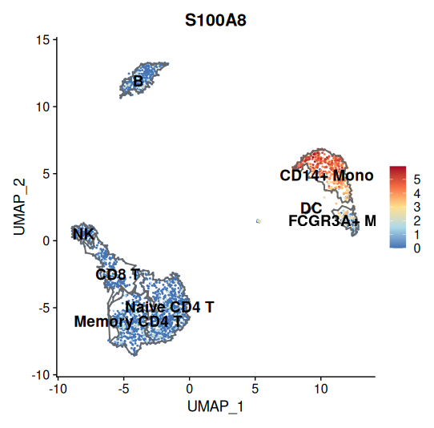
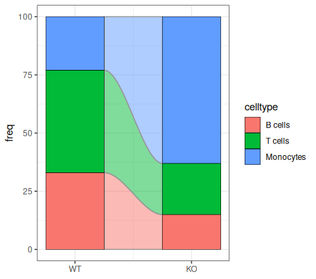

# Collection of data analysis functions

This package gathers a personal collection of helper functions for data analysis, QC, and plotting, etc...

``` r
# install with
install.packages("devtools")

devtools::install_github("vroh/utilityFunction")
# or
devtools::install_gitlab("vroh/utilityFunction")
```

## plot_feature_with_cluster_boundaries

This functions is useful for cluster annotation of Seurat objects. It is similar to `Seurat::FeaturePlot()` but additionaly displays cluster border limits on the UMAP.

``` r
plot_feature_with_cluster_boundaries(seurat_obj = pbmc3k.final, feature = "S100A8", group.by = "seurat_annotations", eps = 40)
```



## stacked_ribbon_plot

This functions plots stacked bars joined by ribbons to highlight proportion changes between groups

``` r
stacked_ribbon_plot(df, "group", "freq", "celltype", reverse_y = F)
```



## make_sample_palette

This functions creates a color palette for replicate samples. The first column in group_cols defines the main color families.
Subsequent columns determine the ordering of base units within each family. Replicates share their base unit’s hue and saturation, differing only in brightness.

``` r
pal <- make_sample_palette(
    coldata,
    replicate_col = "replicate",
    group_cols = c("condition", "tissue", "timepoint"),
    # sample_col = "sample_id",  # Otherwise uses row names
    hue_start = 20,              # Degrees
    hue_spread = 0.90,
    saturation = 0.72,
    saturation_contrast = 0.20,
    value_range = c(0.65, 0.95)
)

# Named sample palette
pal$sample_colors

# Named base-unit palette
pal$base_colors

# Metadata with assigned HSV coordinates and colors
pal$metadata
```
